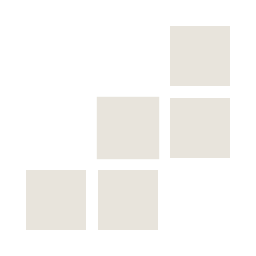
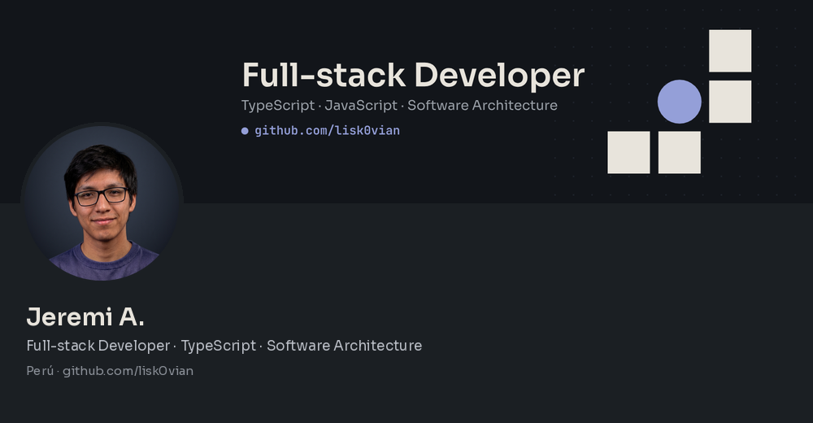
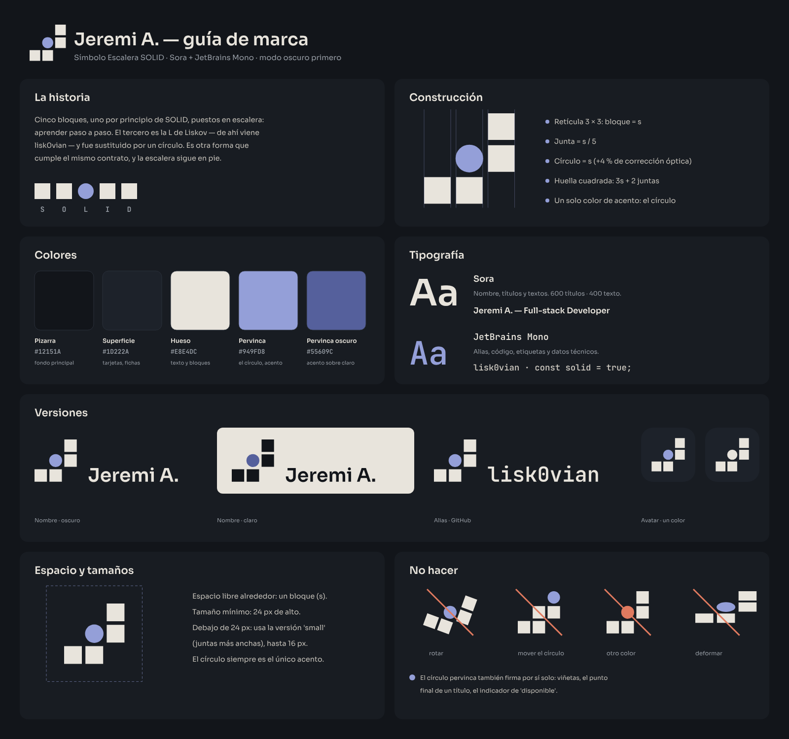

# Branding

> **EN:** Personal brand of Jeremi A. (lisk0vian). The mark, *Escalera SOLID*, is five blocks forming a staircase: S‑O‑L‑I‑D. The third block, **L** for Liskov, is a circle that substitutes for a square. That is the Liskov Substitution Principle, where the alias *lisk0vian* comes from.

## El símbolo

Cinco bloques forman una escalera, uno por cada principio SOLID. El tercero, la **L** de Liskov, es un **círculo que sustituye a un cuadrado** y la escalera sigue en pie. El símbolo cuenta tres cosas:
- de dónde viene *lisk0vian*;
- cómo trabajo: con calma, precisión y orden;
- que siempre sigo subiendo y aprendiendo.

El círculo pervinca es la firma de la marca. Puede ir solo, como un punto delante de un enlace o al final de un título.

## Colores

| | Nombre | HEX | Uso |
|---|---|---|---|
|  | Pizarra | `#12151A` | Fondo principal (modo oscuro primero) |
|  | Superficie | `#1D222A` | Tarjetas, paneles |
|  | Hueso | `#E8E4DC` | Bloques y texto principal |
|  | Niebla | `#9AA0A8` | Texto secundario |
|  | Pervinca | `#949FD8` | Acento: el círculo |
|  | Pervinca oscuro | `#55609C` | Acento sobre fondo claro |

## Tipografía

- **[Sora](https://fonts.google.com/specimen/Sora)**: 600 para títulos y 400 para texto.
- **[JetBrains Mono](https://fonts.google.com/specimen/JetBrains+Mono)**: 600 para `lisk0vian`, enlaces y código.

Las dos son gratuitas y de código abierto (OFL).

## Archivos

| Carpeta | Contenido |
|---|---|
| [`logo/`](logo/) | `symbol` (oscuro, `-light`, `-small`, `-animated`), `lockup` con nombre o con alias `lisk0vian`, `avatar`, `favicon`, `guia` (guía de uso en una página) |
| [`logo/web-icons/`](logo/web-icons/) | `favicon.ico`, PNG 16/32/48, `apple-touch-icon`, iconos 192/512 y maskable, `site.webmanifest`, `head-snippet.html`, versiones negro, blanco y monocolor |
| [`linkedin/`](linkedin/) | `banner.png` listo para subir, `banner.html` editable, `foto.jpg` de perfil y `preview.png` con cómo se ven juntos |
| [`proceso/`](proceso/) | Cómo se llegó aquí: rondas de conceptos, estudio tipográfico, estrategia inicial y los scripts que generan todo |

## Editar el banner de LinkedIn

1. Abre [`linkedin/banner.html`](linkedin/banner.html) en el navegador. Funciona sin internet porque las fuentes van incluidas.
2. Cambia el título, el subtítulo o el enlace. Si un texto no cabe, se achica solo.
3. Marca "Mostrar zona aproximada de tu foto de perfil" para ver qué parte del banner tapa tu foto.
4. Pulsa **Descargar PNG** para obtener la imagen de 1584 × 396 px y súbela a LinkedIn.

## Guía de uso

